# State machines

Everything in Onvif.Open that has a lifecycle is a state machine written down in one place: a table of its states and
allowed moves (`StateMachine<T>` in C#, `defineMachine` in TypeScript, the same shape on both sides). Code changes a
state through the table, tests check the code against it, and the diagrams below are generated from it.

## Rules

- **One table per lifecycle**, next to the code that owns it. Do not set a status anywhere else: call `Move(from, to)`
  (`move` in TypeScript), which refuses a move that is not in the table and names the ones that are.
- **Hot paths do not throw**: the recording loop checks `CanMove` and logs a move outside the table instead.
- **Names are the API**: the states are the strings and enums the API returns; adding a state is a compatible change,
  renaming one is not.
- **Changing a table**: edit it, then run the tests with `UPDATE_STATE_DOCS=1` (`dotnet test` for the backend
  machines, `npm test` in `web/` for the web ones) to redraw the diagrams below. Without it, a stale diagram fails the
  tests (`StateMachinesTest`, `stateMachines.test.ts`).
- **A new machine**: declare it with the helper, add it to the list in that test, and add a section here with an empty
  `machine` block; the test fills it in.

## Machines

| Machine | Side | Table | Changed by | Seen in |
|---|---|---|---|---|
| [Camera recording](#camera-recording) | Backend | `Onvif.Open.Models/Recording/RecordingState.cs` (`RecordingStates.Machine`) | `CameraRecorder.SetState` (logs a move outside the table) | `GET /api/cameras` `state`; Home, Cameras, Live |
| [Plugin](#plugin) | Backend | `Onvif.Open.Models/Plugin/PluginState.cs` (`PluginStates.Machine`) | `PluginRunner` (moves through the table) | `GET /api/plugins` `state` |
| [Export](#export) | Backend | `Onvif.Open.Recorder/Exports/IExportStore.cs` (`ExportStatuses.Machine`) | `ExportService` (moves through the table) | `GET /api/exports` `status`; Exports page |
| [Case](#case) | Backend | `Onvif.Open.Recorder/Cases/CaseHolds.cs` (`CaseStatuses.Machine`) | `CaseService.UpdateAsync` | `GET /api/cases` `status`; Cases pages; open cases keep their video |
| [Alert](#alert) | Backend | `Onvif.Open.Recorder/Alerts/AlertRule.cs` (`AlertStates.Machine`, stored as `AcknowledgedAt`) | `AlertService.AcknowledgeAsync` | `GET /api/alerts` `status`; Alerts inbox and its count |
| [Gateway pairing](#gateway-pairing) | Backend | `Onvif.Open.Recorder/Gateways/GatewayPairing.cs` (`PairingStatus.Machine`) | `GatewayPairing` (in memory) | `GET /api/gateways/pairing/{id}` `state` |
| [Low-latency live stream](#low-latency-live-stream) | Backend | `Onvif.Open.Recording/Implementation/Mp4/Mp4LiveStream.cs` (`Mp4LiveStates.Machine`) | `Mp4LiveStream.Add`, `Close` | `GET /api/cameras/{id}/live.mp4` (503 while waiting, 415 when unsupported) |
| [Grid sub-stream](#grid-sub-stream) | Backend | `Onvif.Open.Recorder/Hosting/LiveViewService.cs` (`SubStreamStates.Machine`) | `LiveViewService` (its reader, and the idle sweep) | `live.mp4?stream=sub` |
| [Session](#session) | Web | `web/src/features/auth/session.ts` (`sessionMachine`, `sessionOf`) | `AuthContext` holds it; `RequireAuth` routes on it | sign-in, password change, sign-out |
| [Add-camera wizard](#add-camera-wizard) | Web | `web/src/features/cameras/wizard/steps.ts` (`wizardSteps`) | `AddCamerasPage` (moves through the table) | Cameras › Add cameras |
| [Camera in the add-camera wizard](#camera-in-the-add-camera-wizard) | Web | `web/src/features/cameras/wizard/candidates.ts` (`candidateMachine`) | `changeCandidate`, `afterSharedChange`, `startTest` | each camera's state in the wizard |
| [Clip marks](#clip-marks) | Web | `web/src/features/investigate/clipMarks.ts` (`markMachine`) | `markIn`, `markOut`, `clearMarks` (move through the table) | Investigate and cases: Mark in / Mark out / Clear |

### Camera recording

Reported to plugins and the API on every change (`CameraStateChange`); Reconnecting starts an `offline` event, Recording ends it (Investigate, alert rules).

<!-- machine: Camera recording -->
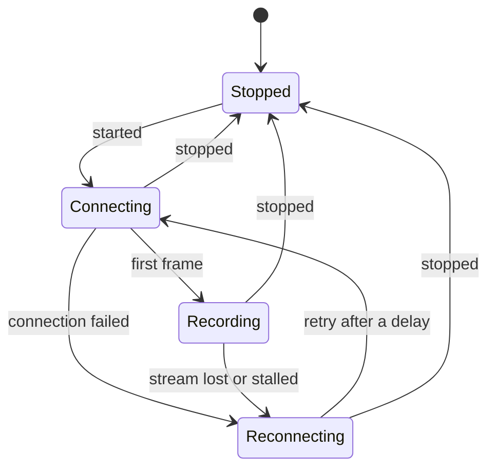
<!-- /machine -->

### Plugin

A faulted plugin receives nothing until the recorder restarts.

<!-- machine: Plugin -->
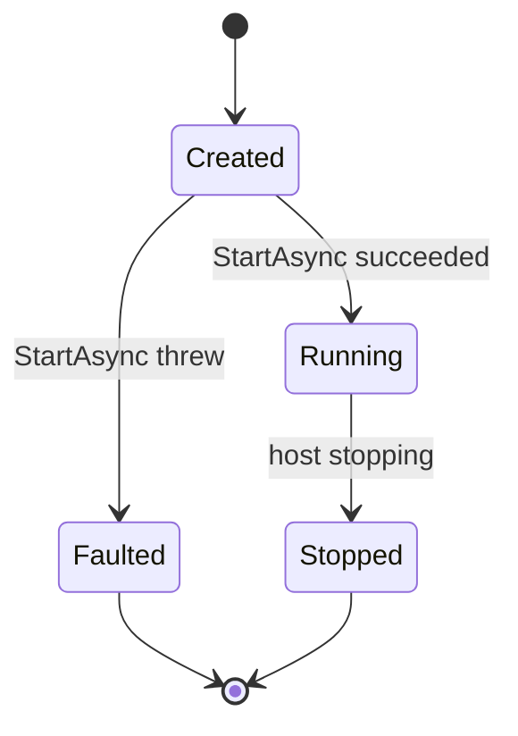
<!-- /machine -->

### Export

An export interrupted by a restart runs again (Running → Running). Failed and Expired are final: export again instead.

<!-- machine: Export -->
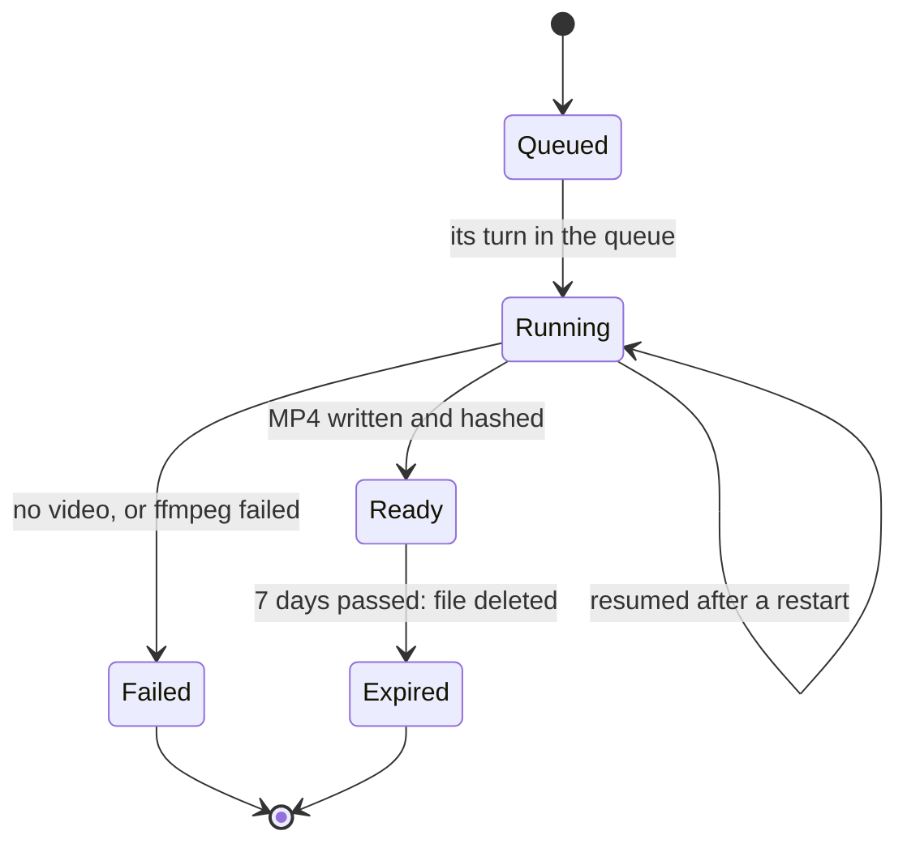
<!-- /machine -->

### Case

While a case is open, retention keeps the video of its clips.

<!-- machine: Case -->
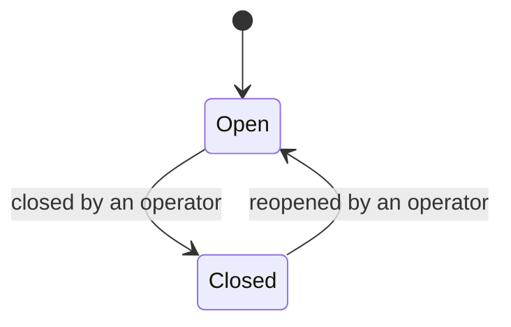
<!-- /machine -->

### Alert

Acknowledging an acknowledged alert keeps the first acknowledgement.

<!-- machine: Alert -->
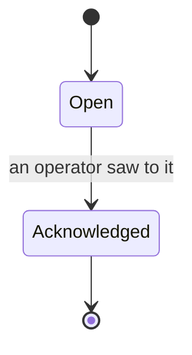
<!-- /machine -->

### Gateway pairing

The gateway side (`ControlPlaneClient`) asks for a new code when one expires.

<!-- machine: Gateway pairing -->
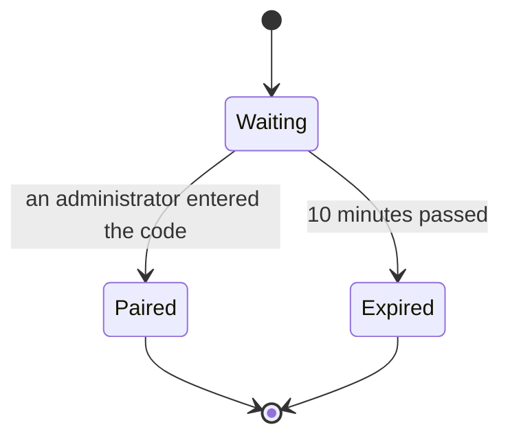
<!-- /machine -->

### Low-latency live stream

A new viewer joins at the last key frame; every drop back to waiting drops the viewers, whose players reconnect.

<!-- machine: Low-latency live stream -->
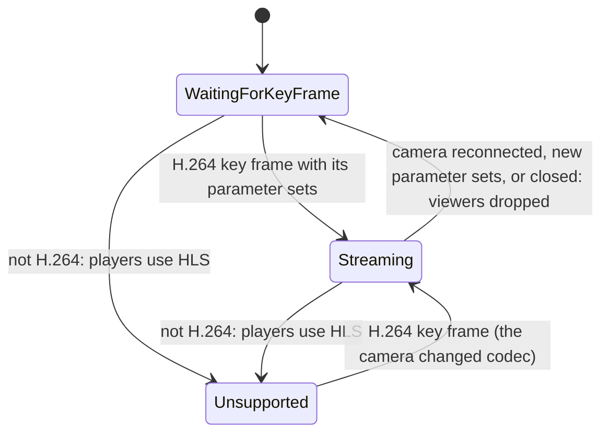
<!-- /machine -->

### Grid sub-stream

A connection to the camera, so it is only open while a grid tile watches it.

<!-- machine: Grid sub-stream -->
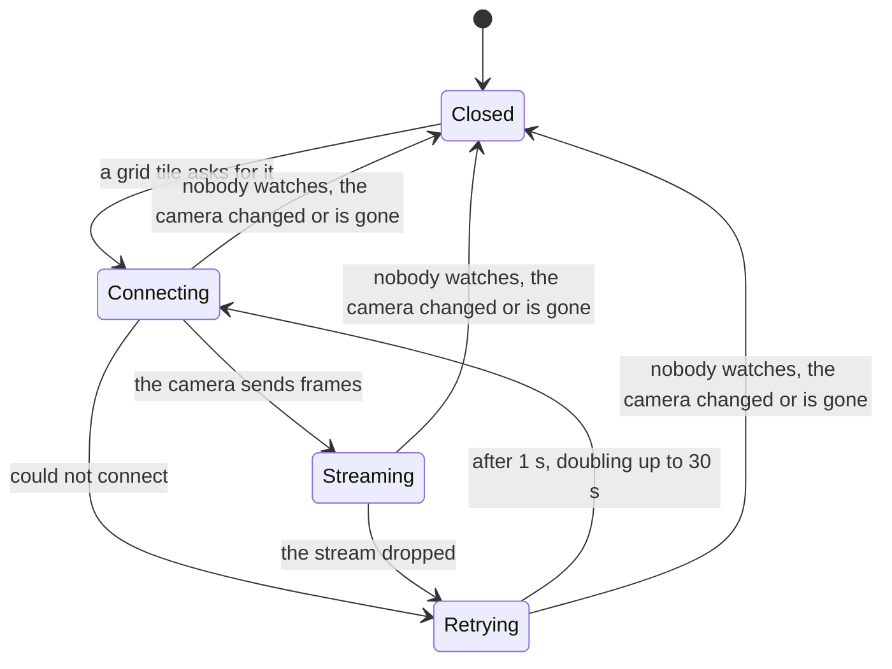
<!-- /machine -->

### Session

A refresh token the recorder rejects signs out from any state (`client.onSignedOut`).

<!-- machine: Session -->
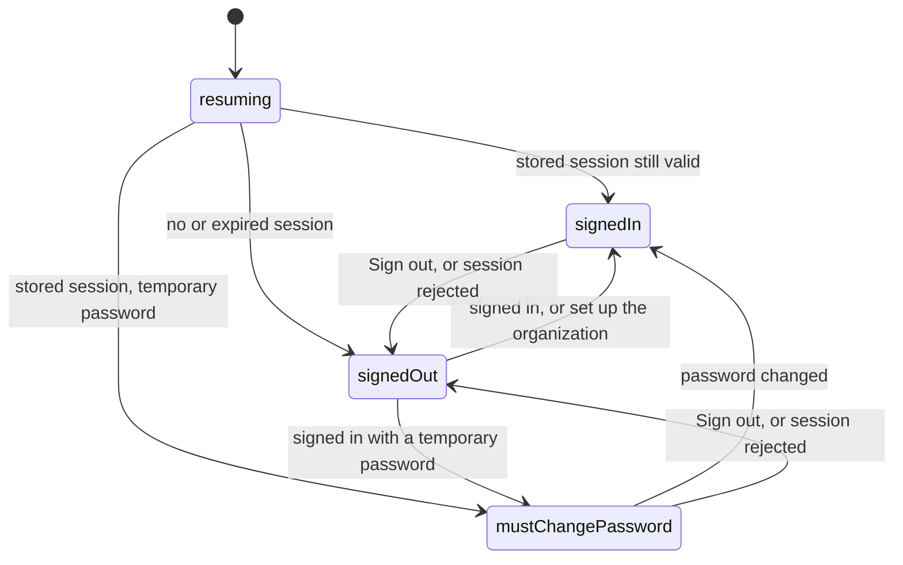
<!-- /machine -->

### Add-camera wizard

Done is final: the cameras were added.

<!-- machine: Add-camera wizard -->
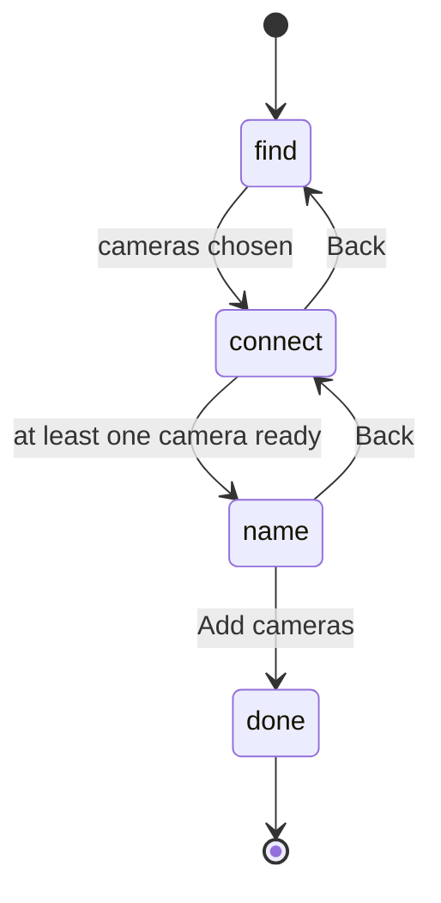
<!-- /machine -->

### Camera in the add-camera wizard

A camera whose sign-in changes after a test is tested again, so it is never added with a password nobody tested. Sign-in fields are locked while a test runs.

<!-- machine: Camera in the add-camera wizard -->
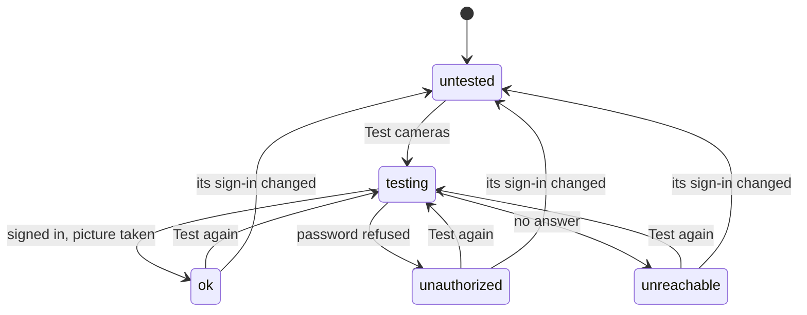
<!-- /machine -->

### Clip marks

A mark on the wrong side of the other one replaces it, so the marks are always in order.

<!-- machine: Clip marks -->
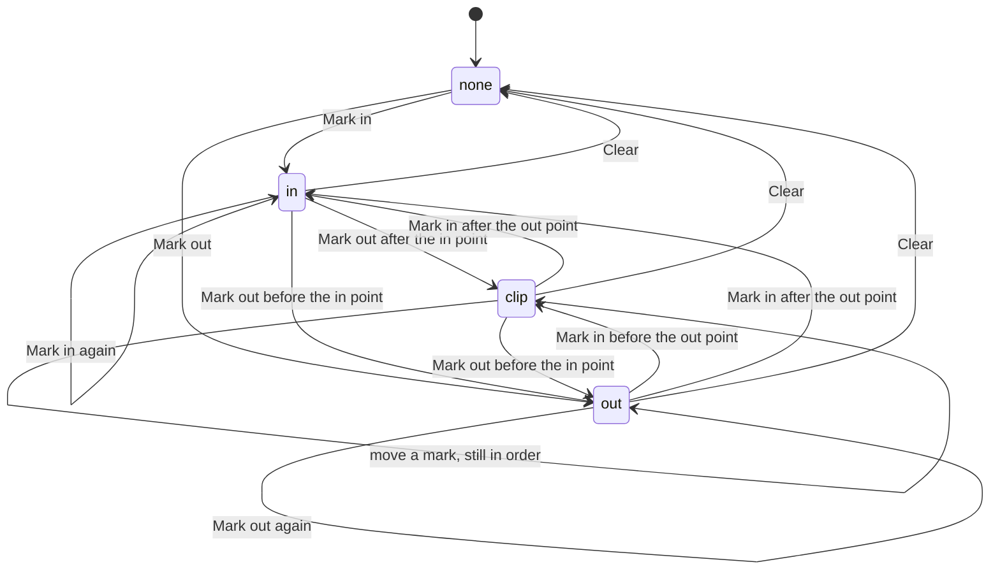
<!-- /machine -->
